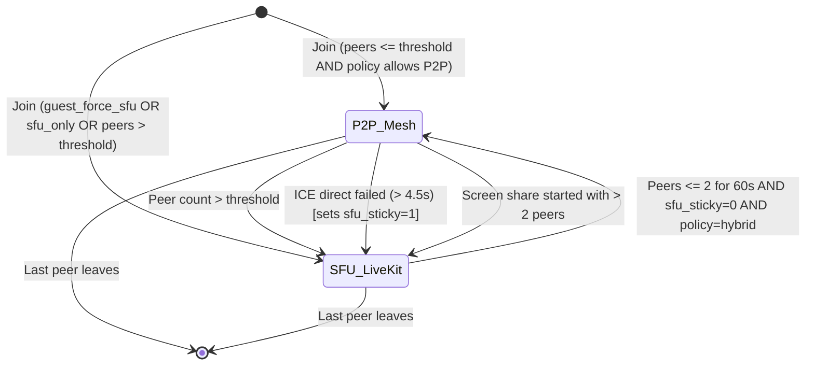

# Native KyMessages Protocol & Hybrid P2P/SFU Media Design

Date: 2026-11-20. Status: draft, awaiting owner review.
Supersedes (if approved): Matrix/Synapse/MAS/Element backend in `docs/PRODUCT.md` and `docs/superpowers/specs/2026-10-01-matrix-platform-design.md`.
Preserves: KyCalendar meeting-room API contract from `docs/superpowers/specs/2026-10-18-kymessages-meeting-rooms-design.md`, KyIdentity SSO/offboarding, KyRecovery capsules, and the `ky_server_base` Go + React 19 + KyUI stack.

---

## 1. Problem Statement & Motivation

Measured benchmarks in `zentrimail-site/demo/RESOURCES.md` (2026-11-20) show that the Matrix stack is the dominant resource bottleneck in the Ky suite:

- **Server RAM floor:** KyMessages idles at **435.1 MiB** across 6 containers (Synapse 223.2 MiB, Postgres 108.0 MiB, MAS 50.4 MiB, LiveKit 23.8 MiB, Element Web 16.8 MiB, Console 12.9 MiB) — nearly double the **226.4 MiB** used by the *entire rest of the Ky suite combined*.
- **Shared PostgreSQL WAL amplification:** As Zentri moves to a **single shared PostgreSQL primary + streaming replica** for the whole hosted suite, Synapse's state-resolution and device-sync churn (**102.4 MiB of WAL in 6 minutes** under 3 light clients against a 28 MB database) is unacceptable on a shared cluster.
- **No native multi-tenancy:** Matrix cannot isolate unrelated Personal or Business tenants on one homeserver without sharing namespaces/directories or spinning up ~300 MiB of Synapse + MAS per tenant.
- **Frontend weight & friction:** Element Web ships a heavy JS + Rust WASM + IndexedDB client with separate branding and requires fragile workarounds for KyCalendar guest waiting rooms.
- **Video bandwidth cost:** LiveKit itself is lightweight (**23.8 MiB idle**, Go, Apache-2.0), but routing every 1:1 and 3-person call through a central SFU burns unnecessary server egress bandwidth.

This specification defines a **native, multi-tenant KyMessages server** built directly on the existing `KyMessage-Server` Go binary (`ky_server_base`), backed by **shared PostgreSQL (primary + read replica)** for hosted deployments and **SQLite** for single-box self-hosting, paired with **hybrid P2P-first WebRTC + LiveKit SFU escalation** for voice, video, and screen sharing.

---

## 2. Goals & Non-Goals

### Goals
1. **Minimal server footprint:** Single stateless Go binary (`~25–40 MiB` idle) serving text chat, signaling, embedded web UI, and admin console across all tenants, plus one shared LiveKit instance (`~24 MiB` idle).
2. **Shared PostgreSQL HA native:** Clean relational schema with `tenant_id` isolation, minimal WAL writes (no ephemeral state in SQL), read-replica offloading for history/search, and horizontal WebSocket fanout via PostgreSQL `LISTEN/NOTIFY` (no Redis/RabbitMQ/NATS).
3. **SQLite parity for self-hosting:** Identical store interface and migrations run on zero-CGO SQLite (WAL mode) for 2 GB stand-alone Business servers.
4. **P2P-first audio/video with zero-rejoin SFU escalation:** Route 1:1 and small calls directly P2P to cut server media egress by ~70–85%, automatically escalating to LiveKit SFU on group growth, screen sharing, privacy policy, or strict NAT/firewall failure (eliminating any separate Coturn server).
5. **First-class KyCalendar meeting rooms:** Native waiting rooms and time-boxed guest links preserving the exact `PUT/DELETE /api/meetings/{id}` `syncauth` API with zero confinement hacks.
6. **Lightweight client:** Fast React 19 + KyUI PWA served directly via `go:embed` with low browser memory and instant cold load.

### Non-Goals
- Matrix Client-Server or Server-Server API compatibility.
- Open, unauthenticated federation across the public internet.
- Unofficial personal-network puppet bridges (WhatsApp, Signal, iMessage, Messenger) that violate upstream ToS and break E2EE.
- Custom MLS / Double-Ratchet text encryption in v1 (schema reserves an `encoding` envelope for optional KyNotes-style room encryption later; voice/video is end-to-end encrypted from day one).

---

## 3. System Topology

### 3.1 Hosted Platform (Shared PostgreSQL HA)

```mermaid
flowchart LR
  Clients["Web / PWA / Mobile Clients"]
  Proxy["Reverse Proxy / LB (TLS)"]
  KM1["kymessages Pod 1 (Go ~30 MiB)"]
  KM2["kymessages Pod 2 (Go ~30 MiB)"]
  PGP[("Shared Suite Postgres Primary")]
  PGR[("Shared Suite Postgres Replica")]
  Blob[("Object / Blob Storage")]
  LK["Shared LiveKit SFU + Built-in TURN (~24 MiB idle)"]

  Clients <-->|"HTTPS REST + WS (/api/v1/ws)"| Proxy
  Proxy <--> KM1
  Proxy <--> KM2
  KM1 <-->|"Writes + LISTEN/NOTIFY"| PGP
  KM2 <-->|"Writes + LISTEN/NOTIFY"| PGP
  KM1 -->|"History / Search Reads"| PGR
  KM2 -->|"History / Search Reads"| PGR
  KM1 -->|"Presigned / Streamed Media"| Blob
  KM2 -->|"Presigned / Streamed Media"| Blob
  Clients <-.->|"P2P Direct DTLS-SRTP (1:1 & small calls)" .-> Clients
  Clients <-->|"SFU Escalation / Strict NAT (SFrame E2EE)"| LK
  KM1 -->|"JWT Mint & Admin Kick"| LK
```

### 3.2 Stand-Alone Self-Hosted (Single Box)
- **2 containers total:** `kymessages` (Go + embedded SQLite + embedded React SPA, `~30–40 MiB`) + `livekit` (`~24 MiB`, optional if voice/video is disabled).
- No PostgreSQL container, no Synapse, no MAS, no Element nginx container.
- Total KyMessages idle RAM drops from **435 MiB → ~60 MiB** (86% reduction), allowing a 5-seat Business server to run comfortably on **2 vCPU / 2 GB RAM**.

---

## 4. Data Model & Storage Layer

Extends `internal/store` (`ky_server_base` dual-engine DAL: SQLite default + PostgreSQL hosted). Existing migrations run through **v22** (`agents`); native messaging tables begin at **migration 23** (append-only, preserving migration history).

### 4.1 Core Tables (Migration 23)

All tenant-scoped tables include `tenant_id TEXT NOT NULL` (default `'default'` on single-tenant self-hosted instances) and enforce tenant isolation in every query predicate and composite index.

```sql
-- Tenants (1 row on self-host; N rows on hosted Zentri platform)
CREATE TABLE tenants (
  id              TEXT PRIMARY KEY,
  slug            TEXT NOT NULL UNIQUE,
  display_name    TEXT NOT NULL,
  plan            TEXT NOT NULL DEFAULT 'business', -- 'personal' | 'business'
  p2p_policy      TEXT NOT NULL DEFAULT 'hybrid',   -- 'hybrid' | 'sfu_only'
  p2p_max_video   INTEGER NOT NULL DEFAULT 2,       -- max peers for P2P video mesh (2..4)
  p2p_max_audio   INTEGER NOT NULL DEFAULT 4,       -- max peers for P2P audio mesh (2..6)
  guest_force_sfu INTEGER NOT NULL DEFAULT 1,       -- hide IPs on external guest calls
  created_at      BIGINT NOT NULL
);

-- Rooms: DMs, group channels, and KyCalendar meeting rooms
CREATE TABLE rooms (
  id              TEXT PRIMARY KEY,                 -- UUIDv7
  tenant_id       TEXT NOT NULL REFERENCES tenants(id),
  kind            TEXT NOT NULL,                    -- 'dm' | 'channel' | 'meeting'
  dm_pair_key     TEXT,                             -- canonical sorted user pair for unique DMs
  name            TEXT NOT NULL DEFAULT '',
  topic           TEXT NOT NULL DEFAULT '',
  is_private      INTEGER NOT NULL DEFAULT 1,
  last_seq        BIGINT NOT NULL DEFAULT 0,        -- monotonic per-room message sequence
  closed_at       BIGINT,                           -- non-null when archived/closed
  created_by      TEXT NOT NULL,                    -- user_id
  created_at      BIGINT NOT NULL,
  UNIQUE (tenant_id, dm_pair_key)
);

-- Room membership + read cursor
CREATE TABLE room_members (
  tenant_id       TEXT NOT NULL,
  room_id         TEXT NOT NULL REFERENCES rooms(id) ON DELETE CASCADE,
  user_id         TEXT NOT NULL,                    -- local user_id or agent_id
  role            TEXT NOT NULL DEFAULT 'member',   -- 'owner' | 'admin' | 'member' | 'bot'
  last_read_seq   BIGINT NOT NULL DEFAULT 0,
  notify_mode     TEXT NOT NULL DEFAULT 'all',      -- 'all' | 'mentions' | 'mute'
  joined_at       BIGINT NOT NULL,
  PRIMARY KEY (room_id, user_id)
);
CREATE INDEX idx_room_members_user ON room_members(tenant_id, user_id);

-- Messages (append-only log per room; edits/deletes update in place with edit_seq)
CREATE TABLE messages (
  id              TEXT PRIMARY KEY,                 -- UUIDv7
  tenant_id       TEXT NOT NULL,
  room_id         TEXT NOT NULL REFERENCES rooms(id) ON DELETE CASCADE,
  seq             BIGINT NOT NULL,                  -- monotonic per room (allocated atomically)
  sender_id       TEXT NOT NULL,                    -- user_id, agent_id, or 'guest:<id>'
  sender_name     TEXT NOT NULL DEFAULT '',         -- snapshot for guests/bots/offboarded users
  reply_to_id     TEXT,                             -- optional parent message_id
  encoding        TEXT NOT NULL DEFAULT 'plain_v1', -- 'plain_v1' | 'e2ee_room_v1' | 'system_v1'
  body            TEXT NOT NULL,                    -- UTF-8 markdown (plain_v1) or base64 ciphertext
  edited_at       BIGINT,
  deleted_at      BIGINT,
  idempotency_key TEXT,
  created_at      BIGINT NOT NULL,
  UNIQUE (room_id, seq),
  UNIQUE (room_id, sender_id, idempotency_key)
);
CREATE INDEX idx_messages_room_seq ON messages(room_id, seq DESC);
CREATE INDEX idx_messages_tenant_created ON messages(tenant_id, created_at DESC);

-- Reactions (compact, bounded per message)
CREATE TABLE message_reactions (
  message_id      TEXT NOT NULL REFERENCES messages(id) ON DELETE CASCADE,
  user_id         TEXT NOT NULL,
  emoji           TEXT NOT NULL,
  created_at      BIGINT NOT NULL,
  PRIMARY KEY (message_id, user_id, emoji)
);

-- Attachment metadata (bytes live in object/blob store, never in SQL)
CREATE TABLE attachments (
  id              TEXT PRIMARY KEY,                 -- UUIDv7
  tenant_id       TEXT NOT NULL,
  room_id         TEXT NOT NULL REFERENCES rooms(id) ON DELETE CASCADE,
  message_id      TEXT REFERENCES messages(id) ON DELETE SET NULL,
  uploader_id     TEXT NOT NULL,
  blob_key        TEXT NOT NULL,
  filename        TEXT NOT NULL,
  mime_type       TEXT NOT NULL,
  size_bytes      BIGINT NOT NULL,
  sha256_hex      TEXT NOT NULL,
  enc_meta        TEXT,                             -- non-null if client-encrypted attachment
  created_at      BIGINT NOT NULL
);
CREATE INDEX idx_attachments_room ON attachments(room_id, created_at DESC);

-- KyCalendar Meetings & Guest Waiting Room (replaces Synapse/MAS guest hacks)
CREATE TABLE meetings (
  id              TEXT PRIMARY KEY,                 -- KyCalendar opaque meeting ID
  tenant_id       TEXT NOT NULL REFERENCES tenants(id),
  room_id         TEXT NOT NULL UNIQUE REFERENCES rooms(id) ON DELETE CASCADE,
  organizer_sub   TEXT NOT NULL,
  title           TEXT NOT NULL,
  closed_at       BIGINT,
  updated_at      BIGINT NOT NULL
);

CREATE TABLE meeting_windows (
  meeting_id      TEXT NOT NULL REFERENCES meetings(id) ON DELETE CASCADE,
  starts_at       BIGINT NOT NULL,
  ends_at         BIGINT NOT NULL,
  PRIMARY KEY (meeting_id, starts_at, ends_at)
);

CREATE TABLE meeting_guests (
  id              TEXT PRIMARY KEY,                 -- UUIDv7 (opaque internal guest_id)
  meeting_id      TEXT NOT NULL REFERENCES meetings(id) ON DELETE CASCADE,
  guest_key       TEXT NOT NULL,                    -- KyCalendar opaque attendee key
  token_hash      TEXT NOT NULL UNIQUE,             -- SHA-256 of 256-bit guest link token
  revoked_at      BIGINT,
  created_at      BIGINT NOT NULL,
  UNIQUE (meeting_id, guest_key)
);

-- Active Call Sessions (small, short-lived rows for HA coordination)
CREATE TABLE call_sessions (
  id              TEXT PRIMARY KEY,                 -- UUIDv7
  tenant_id       TEXT NOT NULL,
  room_id         TEXT NOT NULL REFERENCES rooms(id) ON DELETE CASCADE,
  mode            TEXT NOT NULL,                    -- 'p2p_mesh' | 'sfu_livekit'
  epoch           INTEGER NOT NULL DEFAULT 1,       -- incremented on every mode migration
  sfu_sticky      INTEGER NOT NULL DEFAULT 0,       -- 1 if ICE failure forced SFU (no step-down)
  livekit_room    TEXT,                             -- '<tenant_id>:<call_id>' when SFU active
  started_by      TEXT NOT NULL,
  started_at      BIGINT NOT NULL,
  ended_at        BIGINT
);
CREATE INDEX idx_call_sessions_active ON call_sessions(room_id) WHERE ended_at IS NULL;

-- Outbound/Inbound Webhooks & Bot Tokens (extends existing AgentStore)
CREATE TABLE room_webhooks (
  id              TEXT PRIMARY KEY,
  tenant_id       TEXT NOT NULL,
  room_id         TEXT NOT NULL REFERENCES rooms(id) ON DELETE CASCADE,
  name            TEXT NOT NULL,
  direction       TEXT NOT NULL,                    -- 'incoming' | 'outgoing'
  token_hash      TEXT NOT NULL,                    -- SHA-256 of secret
  target_url      TEXT,                             -- for outgoing webhooks
  created_by      TEXT NOT NULL,
  revoked_at      BIGINT,
  created_at      BIGINT NOT NULL
);
```

### 4.2 PostgreSQL Read/Write & WAL Discipline

| Operation | DB Target | WAL Impact |
| :--- | :--- | :--- |
| Send message (`UPDATE rooms SET last_seq = last_seq + 1 RETURNING last_seq` + `INSERT INTO messages` in 1 txn) | **Primary** | ~250–600 bytes/msg (100x+ smaller than Synapse) |
| Edit / delete / react / room membership | **Primary** | Minimal single-row writes |
| Read cursor (`last_read_seq`) | **Primary** (client-debounced every 3–5s or on blur) | Negligible |
| Paginate history, list rooms, full-text search (`tsvector` on PG / FTS5 on SQLite) | **Read Replica** (fallback to primary if lag-sensitive after own write) | **Zero** |
| Typing indicators, online presence, WebRTC SDP/ICE signaling, waiting-room knocks | **Memory + PG `LISTEN/NOTIFY` only** | **Zero** |
| File attachments | **Object / Blob store** (only metadata row in PG) | **Zero blob WAL** |

---

## 5. Application Protocol

### 5.1 REST API (`/api/v1/...`)

All authenticated browser calls use the existing HttpOnly `SameSite=Lax` KyIdentity session cookie (with CSRF origin/header verification); bots, agents, and future mobile clients use `Authorization: Bearer <token>`.

| Method & Path | Purpose |
| :--- | :--- |
| `GET /api/v1/bootstrap` | Returns current user, tenant capabilities (`p2p_policy`, ICE config), room list, unread counts, and active call summaries in **one round trip**. |
| `POST /api/v1/rooms` | Create channel or get-or-create 1:1 DM (`dm_pair_key`). |
| `PATCH /api/v1/rooms/{id}` / `POST .../members` / `DELETE .../members/{uid}` | Manage room metadata and membership. |
| `GET /api/v1/rooms/{id}/messages?before=<seq>&after=<seq>&limit=50` | Cursor-based history pagination or reconnect catch-up. |
| `POST /api/v1/rooms/{id}/messages` | Send message with `idempotency_key`; returns assigned `seq` and `id`. |
| `PATCH /api/v1/rooms/{id}/messages/{msg_id}` / `DELETE ...` | Edit or soft-delete message. |
| `PUT /api/v1/rooms/{id}/messages/{msg_id}/reactions/{emoji}` | Toggle reaction. |
| `PUT /api/v1/rooms/{id}/read` | Advance `last_read_seq` (monotonic `GREATEST`). |
| `GET /api/v1/search?q=...&room_id=...` | Full-text search across rooms the caller belongs to (only indexes `plain_v1` rows). |
| `POST /api/v1/rooms/{id}/attachments` / `GET /api/v1/attachments/{id}` | Stream upload/download via blob store with membership check and size/MIME limits. |
| `POST /api/v1/rooms/{id}/calls/join` | Start or join a call; returns current mode (`p2p_mesh` or `sfu_livekit`), peer roster, ICE servers, and (if SFU) short-lived LiveKit JWT. |
| `POST /api/v1/calls/{id}/leave` | Leave call cleanly (also triggered automatically on WS disconnect grace timeout). |
| `POST /api/v1/calls/{id}/escalate` | Client reports ICE failure, screen-share upgrade, or policy trigger; server upgrades call to `sfu_livekit`. |
| `PUT /api/meetings/{id}` / `DELETE /api/meetings/{id}` | Existing `syncauth`-signed KyCalendar meeting lifecycle endpoint. |
| `POST /api/v1/webhooks/in/{id}` | Slack-compatible incoming webhook (`{text, blocks?}`) for CI/alerts/integrations. |

### 5.2 Multiplexed WebSocket (`/api/v1/ws`)

One persistent WebSocket connection per client tab/device (using `coder/websocket` or `gorilla/websocket`, ~4–8 KiB RAM per socket in Go).

**Frame envelope:**
```json
{
  "t": "msg.new",
  "id": "019a...",
  "room_id": "019a...",
  "seq": 418,
  "p": { "...event payload..." }
}
```

**Event types:**
- **Server → Client:** `hello` (heartbeat interval + server epoch), `msg.new`, `msg.edit`, `msg.del`, `msg.react`, `room.update`, `room.member`, `read.sync`, `typing`, `presence`, `call.state`, `call.signal` (SDP/ICE/E2EE key exchange), `call.migrate`, `lobby.knock`, `lobby.admitted`, `lobby.denied`, `auth.revoked`.
- **Client → Server:** `ping`, `typing`, `call.signal` (addressed to specific `to_peer_id`), `call.migrated` (ack after LiveKit handover), `call.ice_failed`, `lobby.decision` (`admit` | `deny`).

**Reconnect catch-up:** On reconnect, the client sends `GET /api/v1/bootstrap` (or per-open-room `GET /messages?after=<last_seen_seq>`). Because `seq` is strictly monotonic per room, missed-event recovery is a single indexed range scan with zero missed gaps and no server-side sync cursors to store.

### 5.3 Multi-Node Fanout via PostgreSQL `LISTEN/NOTIFY`

When running multiple stateless `kymessages` pods behind a load balancer:
1. Each pod maintains an in-memory map `room_id -> set<*ClientConn>` and `peer_id -> *ClientConn`.
2. Each pod opens **one** dedicated connection to the PostgreSQL primary listening on a bounded set of shard channels (`km_bus_0` .. `km_bus_15`, hashed by `room_id`) so PostgreSQL never tracks thousands of per-room channels.
3. On any write or ephemeral signal, the handling pod executes `SELECT pg_notify('km_bus_' || shard, payload)` where `payload` is compact JSON (`<= 4 KiB`, well under PG's 8 KiB limit).
   - For chat messages larger than 2 KiB, the notification carries `{t:"msg.new", room_id, seq, id}` and pods with local subscribers fetch the row once (or send inline when `< 2 KiB`, which covers ~95% of chat messages).
4. Every pod receiving the `NOTIFY` checks its local `room_id` subscriber map and writes directly to matching WebSockets (or drops in O(1) if no local subscribers).
5. On single-node SQLite deployments, the bus is an in-process Go channel with the exact same `EventBus` interface.

### 5.4 Instant Offboarding (KyIdentity)

When KyIdentity sends a `deleted` or `suspended` event to `/api/sso/kyidentity/sync` (or SCIM deprovisions a user):
1. `kymessages` revokes the user's sessions and marks their directory state inside one DB transaction.
2. Publishes `auth.revoked` for `user_id` on the event bus → every pod immediately closes that user's open WebSockets.
3. Calls LiveKit's `RemoveParticipant` API for any active SFU call the user is in, and broadcasts `call.peer_left` to any P2P peers so their browsers close the peer connection immediately.

---

## 6. Hybrid P2P + SFU Audio/Video Conferencing

### 6.1 Architecture Principle: P2P by Default, SFU on Demand

In typical small-team and personal usage, **70–85% of call minutes are 1:1 or 3-person calls**. Routing those directly between browsers costs **0 bytes of server media bandwidth**, while automatic escalation to LiveKit guarantees enterprise-grade reliability for larger meetings, screen sharing, IP-private guest calls, and restrictive corporate networks.



### 6.2 Mode Selection Rules (Server-Authoritative)

Evaluated by `kymessages` on every `join`, `leave`, `escalate`, or `screen_share` event:

| Condition | Selected Mode | Rationale |
| :--- | :--- | :--- |
| Tenant `p2p_policy == 'sfu_only'` | `sfu_livekit` | Admin opted into server-relayed media only (e.g., hide all client IPs). |
| Room has an active external guest AND `guest_force_sfu == 1` (default) | `sfu_livekit` | Prevents exposing employee/guest home or office IP addresses via ICE candidates. |
| Video active AND `active_peers <= tenant.p2p_max_video` (default **2**, configurable up to **3–4**) | `p2p_mesh` | 1:1 video (1 uplink/peer) or optional 3-way mesh (2 uplinks/peer) with zero server egress. |
| Audio-only AND `active_peers <= tenant.p2p_max_audio` (default **4**) | `p2p_mesh` | Opus audio is ~32–48 kbps per stream; 4-way audio mesh uses <150 kbps uplink/peer. |
| `active_peers` exceeds threshold, OR screen share with `>2` peers, OR any peer reports ICE failure | `sfu_livekit` | LiveKit SFU handles simulcast, SVC, active-speaker layer switching, and TLS-443 TURN. |

### 6.3 P2P Signaling & Glare Prevention (Zero Extra Services)

P2P calls reuse `/api/v1/ws` — no extra signaling server is needed:
1. Each joining client gets a unique `peer_id` (UUIDv7) and the current peer list from `POST /api/v1/rooms/{id}/calls/join`.
2. **Deterministic Perfect Negotiation (RFC 8829 / MDN pattern):** Between any pair `(A, B)`, the lexicographically smaller `peer_id` is **polite** and the larger is **impolite**. Only the impolite peer sends the initial SDP offer; glare collisions resolve deterministically without deadlocks.
3. **Trickle ICE:** Candidates flow over `call.signal { call_id, to_peer_id, kind: "ice" | "offer" | "answer", data }`.
4. **STUN only for P2P (No Separate Coturn Needed):**
   - Clients receive STUN server URLs (pointing at LiveKit's built-in STUN listener or your edge STUN endpoint — negligible ~200-byte UDP packets).
   - **Automatic NAT Fallback:** If a P2P `RTCPeerConnection` does not reach `connected` within **4.5 seconds** (e.g., double symmetric NAT or UDP-blocked corporate Wi-Fi), the client calls `POST /api/v1/calls/{id}/escalate { reason: "ice_failed" }`.
   - The server sets `sfu_sticky = 1`, switches the call to `sfu_livekit`, and hands both peers LiveKit JWTs. LiveKit's built-in **TCP/TLS-443 TURN** completes the connection seamlessly.
   - **Result:** ~85–90% of 1:1 calls punch through directly at **zero bandwidth cost**; the ~10–15% behind strict firewalls automatically fail over to LiveKit with **zero Coturn container to deploy or maintain**.

### 6.4 Make-Before-Break Live Handover (`p2p_mesh` ↔ `sfu_livekit`)

When a 3rd participant joins an active 1:1 P2P call (or ICE fails / screen share triggers escalation):

1. Server atomically increments `call_sessions.epoch`, sets `mode = 'sfu_livekit'`, and creates `livekit_room = "<tenant_id>:<call_id>"`.
2. Server mints short-lived LiveKit JWTs (15-minute TTL, scoped strictly to `livekit_room`, `canPublish`, `canSubscribe`, `participantIdentity = peer_id`) for every active peer and the joining peer.
3. Server broadcasts `call.migrate { call_id, epoch, target_mode: "sfu_livekit", livekit_url, token }` over WebSocket.
4. **Zero-click client handover:**
   - Existing P2P clients **keep their live P2P tracks playing** while opening the LiveKit `Room` connection in the background.
   - They publish the **same existing `MediaStreamTrack` objects** (camera/mic) to LiveKit — no hardware re-initialization and no browser permission re-prompt.
   - Once LiveKit reaches `Connected` and publishes local tracks (or after a 2.5s timeout), the client switches its `<video>`/`<audio>` sinks to the LiveKit tracks, sends `call.migrated { call_id, epoch }`, and closes the old P2P `RTCPeerConnection`s.
   - Total audible/visual switchover glitch: **< 200 ms**; total handover latency: **~0.8–1.5 s**.
5. **Hysteretic Step-Down (`sfu_livekit` → `p2p_mesh`):**
   - If a call drops back to `<= 2` peers, `sfu_sticky == 0`, and no external guest is present, the server starts a **60-second cooldown timer** (avoiding churn if someone briefly reconnects).
   - If still `<= 2` peers after 60s, the server increments `epoch`, sends `call.migrate { target_mode: "p2p_mesh" }`, clients establish P2P in the background, switch sinks, and disconnect from LiveKit — returning server egress to zero.

### 6.5 End-to-End Media Encryption (P2P + SFU)

| Mode | Media Transport Security | End-to-End Encryption |
| :--- | :--- | :--- |
| **`p2p_mesh`** | Direct **DTLS-SRTP** between peers | Inherently E2EE (neither `kymessages` nor LiveKit ever sees media packets). |
| **`sfu_livekit`** | DTLS-SRTP to LiveKit SFU | **LiveKit `FrameCryptor` (SFrame-inspired AES-128-GCM)** via `RTCRtpScriptTransform` (Baseline in Chrome 141+, Safari 15.4+, Firefox 117+, plus native iOS/Android SDKs). |

**Zero-server-knowledge call key distribution:**
- When a call starts (or escalates to SFU), the first active internal peer generates a 256-bit random `call_media_key` (with monotonic `key_index`).
- Each client generates an ephemeral `ECDH P-256` keypair per call session and announces its public key in `call.join`.
- The key holder wraps `call_media_key` for each authorized peer using `ECDH + HKDF-SHA256 + AES-GCM` and forwards the wrapped ciphertext via `call.signal { kind: "e2ee_key" }`.
- When any peer leaves or is kicked (including offboarded users or expired guests), the key holder rotates `key_index += 1` with a fresh random key distributed only to remaining peers (preventing future decryption by removed peers).
- Neither `kymessages` nor `livekit` ever possesses `call_media_key`.

### 6.6 IP Privacy Controls

Because direct P2P exposes peer IP addresses in ICE candidates:
- **External guest meetings:** Default `guest_force_sfu = 1` → guests **never** connect P2P; they always traverse LiveKit SFU.
- **Personal tier (shared instance):** Can default to `sfu_only` for calls between users who are not mutually trusted contacts, or expose a per-user **"Protect IP address (always relay calls)"** toggle in client settings (mirrors Signal/WhatsApp). If *either* peer has IP protection enabled, the server selects `sfu_livekit`.

---

## 7. KyCalendar Meeting Rooms & External Guest Waiting Rooms

Preserves the exact `PUT /api/meetings/{id}` and `DELETE /api/meetings/{id}` `syncauth` v1 contract defined in `docs/superpowers/specs/2026-10-18-kymessages-meeting-rooms-design.md`, while eliminating all Matrix guest workarounds (no `guest-*` MAS accounts, no Element storage bootstrap page, no Synapse confinement module):

1. **`PUT /api/meetings/{id}`** creates/updates a `rooms` row (`kind = 'meeting'`), reconciles `room_members`, replaces `meeting_windows`, and hashes each new `meeting_guests.token_hash`. Returns `{member_url, guest_urls}`.
2. **Guest arrival (`/meet/<token>`):**
   - Outside all `meeting_windows`: renders meeting title + next opening time; allocates zero server state.
   - Inside a window: guest enters a display name (1–64 chars, no control chars) and solves the existing proof-of-work challenge (rate-limited: 10 attempts / IP / 15 min; max 1 active session per token).
3. **Waiting room:**
   - Guest opens a scoped WebSocket (`/api/v1/ws?guest_ticket=...`) locked strictly to `{meeting_id, guest_id}` in `waiting` state.
   - Server broadcasts `lobby.knock { guest_id, display_name }` to all internal members of the meeting room.
   - Because guests are **not** ordinary user accounts, confinement is structural by default: a guest ticket has zero permission to list users, create rooms, upload arbitrary files, or access any other endpoint.
4. **Admission & Call Join:**
   - Any internal room member clicks **Admit** (`lobby.decision: admit`).
   - Server marks the guest session `admitted` (in-memory + audited `guest.admit`) and immediately issues a LiveKit JWT (valid until `min(now + 15m, window_end)`) plus read/write access to that meeting's chat stream only.
   - **Leaving means waiting again:** If the guest disconnects for >20s, their `admitted` state clears; reconnecting returns them to the waiting room.
5. **Window expiry:** A lightweight background ticker revokes expired guest tickets, closes their WebSockets, calls LiveKit `RemoveParticipant`, and logs `guest.expire` (IDs/hashes only — never display names, titles, or tokens).

---

## 8. Interoperability Strategy

| Priority | Surface | Specification |
| :--- | :--- | :--- |
| **MVP (v1)** | **Browser Guest Meetings + `.ics`** | One-click `/meet/<token>` URL in any modern browser; zero account or install required. |
| **MVP (v1)** | **Ky Suite Integration** | KyIdentity OIDC + instant webhook/SCIM offboarding, KyCalendar `syncauth` rooms, KyDrive file links, KyPost missed-DM email digests, KyRecovery capsules. |
| **MVP (v1)** | **Bot & Webhook API** | REST + WebSocket bot tokens (`agents` table from migration 22) for OpenClaw/Hermes agents + Slack-compatible incoming webhooks + signed outgoing webhooks. |
| **Phase 2 (Optional)** | **Ky-to-Ky Allow-List Federation** | Ed25519-signed HTTPS server-to-server push (`/.well-known/kymessages`), home-server-authoritative rooms (no distributed DAG conflict resolution), explicit admin domain allow-list. User handles use email form (`user@domain`) so future **IETF MIMI** interop stays viable. |
| **Phase 3 (If Demanded)** | **Official API Connectors** | Optional standalone sidecar processes bridging official APIs only (Slack, Microsoft Graph/Teams, Discord bots, Telegram bots) via KyMessages' Bot/Webhook API. Unofficial WhatsApp/Signal/iMessage puppet bridges remain out of scope. |

---

## 9. Text Encryption & Search Strategy

- **Default in v1 (`plain_v1`):** TLS 1.3 in transit + PostgreSQL/disk encryption at rest (same trust model as Slack, Microsoft Teams, and Mattermost).
  - Enables fast Postgres full-text search, instant history on new devices, trivial bot/agent integration, and zero browser WASM/key-recovery friction.
  - **Voice & video remain end-to-end encrypted** via DTLS-SRTP (P2P) and ECDH-keyed SFrame (LiveKit SFU).
- **Forward-compatible upgrade path (`e2ee_room_v1`):** The `messages.encoding` and `attachments.enc_meta` columns reserve space for optional KyNotes-style per-room client encryption (WebCrypto AES-GCM room keys wrapped per member) without altering wire framing or storage tables.

---

## 10. Backups & Disaster Recovery (KyRecovery)

- **Hosted (Shared PostgreSQL HA):** Handled uniformly by the suite's PostgreSQL primary/replica + WAL archiving/PITR and blob storage replication. No special Matrix dump/one-time-key truncation steps.
- **Self-Hosted (SQLite):** `internal/backup` uses SQLite online backup (`VACUUM INTO`) into the existing sealed KyRecovery capsule (`<= 256 MiB`) plus the existing `mirror-blobs` pattern from KyNotes for attachments. Restores cleanly offline without Synapse's `e2e_one_time_keys_json` corruption hazard.

---

## 11. Resource, Bandwidth & Cost Budget

### 11.1 Server Compute & Memory
| Deployment | Matrix Stack (Measured) | Native KyMessages + LiveKit (Target) | Reduction |
| :--- | :--- | :--- | :--- |
| **Stand-alone 5-seat Business box** | 6 containers · **435 MiB** idle · 1,569 MB images | 2 containers · **~60 MiB** idle · ~190 MB images | **-86% RAM**, keeps 5-seat box on **2 GB VPS** |
| **Hosted Shared-PG Platform (100+ Personal + N Business orgs)** | ~303 MiB per isolated org + 102 MiB/6 min PG WAL churn | **1 stateless Go service (~30–60 MiB)** + **1 shared LiveKit (~24 MiB idle)** | **>90% compute & WAL savings** |

### 11.2 Media Bandwidth Savings (Hybrid P2P vs. SFU-Only)

Assumptions: 720p video at ~1.5 Mbps/sender; realistic small-business call mix of **75% 1:1 calls, 15% 3–4 person calls, 10% 5+ person calls**; 12% of 1:1 calls hit strict NAT and auto-escalate to LiveKit.

| 1,000 Call-Hours / Month | SFU-Only (LiveKit Always) | Hybrid P2P + SFU (`p2p_max_video=2`) | Savings |
| :--- | :--- | :--- | :--- |
| 750 hrs 1:1 calls | ~1,012 GB server egress | ~121 GB *(only 12% NAT fallback)* | **-88%** |
| 150 hrs 3-person calls | ~608 GB server egress | ~608 GB *(or ~73 GB if `p2p_max_video=3`)* | 0% *(or -88%)* |
| 100 hrs 5-person calls | ~1,350 GB server egress | ~1,350 GB | 0% |
| **Total Server Egress** | **~2,970 GB / mo** | **~2,079 GB / mo** *(~1,544 GB with 3-way P2P)* | **-30% to -48% overall (-88% on 1:1 calls)** |

*Note: On a bandwidth-generous media host (e.g., Hetzner/OVH with 20 TB included), a single €10–€20/mo LiveKit node comfortably handles ~6,000–12,000+ monthly meeting hours under hybrid P2P.*

---

## 12. Phased Delivery Plan & Verification Gates

1. **Phase 1 — Core Chat Backend & Multi-Tenant Store (~2 weeks)**
   - Migration 23 (PG + SQLite), `internal/chat` service, REST API, `/api/v1/ws` hub, `LISTEN/NOTIFY` multi-pod bus, KyIdentity instant revocation, and `make test-postgres` + dual-engine tests.
   - **Gate:** Load test proves `<100 MiB` RAM and `<5 MiB` PG WAL across 500 concurrent sockets sending 50 msg/s.
2. **Phase 2 — Thin React + KyUI Chat Client (~1.5 weeks)**
   - Embedded SPA (`go:embed`): rooms, DMs, threads/replies, reactions, attachments, search, read cursors, responsive mobile PWA + Web Push notifications.
   - **Gate:** Cold browser load `<500 KB` gzipped JS, browser tab `<80 MiB` RAM.
3. **Phase 3 — Hybrid P2P + LiveKit Video & Guest Waiting Rooms (~2 weeks)**
   - P2P WebRTC Perfect Negotiation over `/api/v1/ws`, STUN + 4.5s ICE-failure auto-escalation to LiveKit, make-before-break handover (`p2p_mesh` ↔ `sfu_livekit`), ECDH SFrame E2EE key exchange, and KyCalendar `PUT/DELETE /api/meetings/{id}` waiting rooms.
   - **Gate:** Automated Playwright acceptance tests verifying: (a) 1:1 call connects P2P with 0 LiveKit bytes, (b) 3rd joiner triggers seamless SFU migration without dropping audio/video, (c) blocked-UDP peer auto-escalates to LiveKit TURN within 5s, (d) external guest waits, gets admitted, is kicked on leave, and expires at window end.
4. **Phase 4 — Matrix Retirement & Cutover (~1 week)**
   - Retire `docker-compose.matrix.yml`, Synapse/MAS/Element manifests in `ky-kubernetes`, update `KyRecovery` capsule format, and re-run `zentrimail-site/demo/RESOURCES.md` benchmark.

---

## 13. Open Decisions for Owner Sign-Off

1. **Text encryption default:** Confirm `plain_v1` (TLS + encrypted at rest + server search, with E2EE on all voice/video calls) for v1, or require `e2ee_room_v1` at launch (+3–4 weeks, no server-side search).
2. **Default P2P video ceiling (`p2p_max_video`):** Recommend **`2`** (safest CPU/uplink for laptops/phones; 88% savings on 1:1 calls) or **`3`** (higher bandwidth savings at ~2x client upload on 3-way calls).
3. **External guest IP privacy (`guest_force_sfu`):** Recommend **`1` (SFU-only for guest meetings)** so neither staff nor external guests see each other's IP addresses.
4. **Mobile strategy:** Confirm **PWA-first** for v1 (deferring native iOS CallKit / Android ConnectionService wrapper until demand justifies store maintenance).
