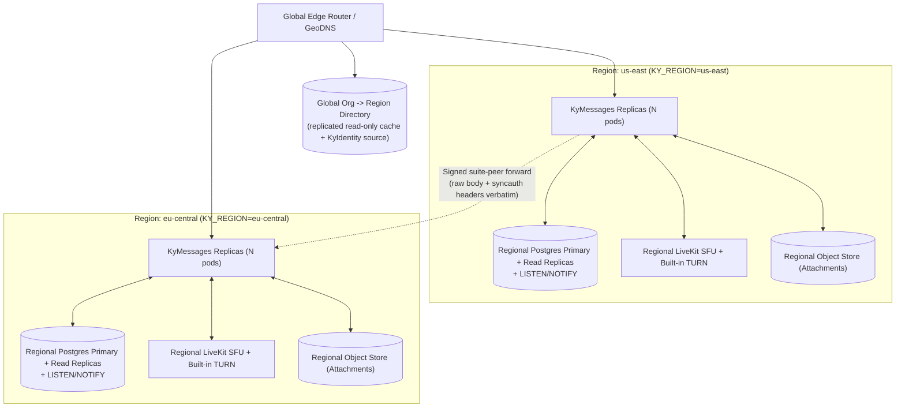

# KyMessages-Native Tenancy, Suite Peer `org_id`, and Multi-Region Design

Date: 2026-11-22. Status: proposed design (core org isolation in PR #18 is built; suite peer
routes, strict single-mode `org_id` rejection, and multi-region routing are specified here and
not yet implemented).

This is the authoritative tenancy, suite-peer `org_id`, and multi-region contract for
KyMessages-Native (`Busnes-app/KyMessages-Native`). It folds in the SaaS tenancy requirements
from KyIdentity (`KyIdentity-server` `docs/superpowers/specs/2026-11-19-tenancy-design.md`,
cited as **T**), KyCalendar (`KyCalendar` `docs/superpowers/specs/2026-11-20-tenancy-design.md`),
KyDrive (`KyDrive-server` `docs/superpowers/specs/2026-11-20-tenancy-design.md`), and KyPost
(`KyPost-Server` `docs/superpowers/specs/2026-11-20-tenancy-design.md`, "PR 3 as built", and
`backend/internal/api/kymessage_handlers.go`, `kymessage_ooo.go`, `kymessage_status.go`).

Code references below are verified against `Busnes-app/KyMessages-Native` `feat/web-push` at
`8a71712` (which includes PR #18 `feat/tenancy-and-docs` and PR #19
`docs/retire-matrix-agents-md`).

---

## 1. Owner Decisions (Fixed, Not Reopened)

1. **One binary, two tenancy modes.** `KY_TENANCY_MODE=single` (default) preserves self-hosted
   single-organization deployments byte for byte on upgrade. `KY_TENANCY_MODE=multi` isolates
   multiple KyIdentity organizations strictly by verified `org_id` inside one deployment.
2. **One KyIdentity issuer, canonical `org_id`.** All hosted orgs share one KyIdentity issuer.
   ID tokens, directory webhooks, and multi-tenant suite-peer bodies carry KyIdentity's opaque
   `org_id` (canonical lowercase UUID). One org per account; no org switcher.
3. **Only staff are administrators; customers are members.** In `KY_TENANCY_MODE=multi`,
   customer orgs have no administrators. Only accounts in `KY_STAFF_ORG_ID` may hold the
   install-wide admin role, and staff cannot read customer chat content. Single-tenant installs
   keep local and directory administrators unchanged.
4. **No billing code in KyMessages-Native.** Stripe lives exclusively in a separate billing
   service. Org activation, suspension, resumption, and deletion enter KyMessages-Native only
   through signed KyIdentity org lifecycle webhooks.
5. **Multi-host replicas and multi-region.** Multi-tenant deployments run as stateless replicas
   across multiple hosts and across multiple regions (home-region cells per org; see §6).
6. **Zero cross-org boundaries.** Rooms, DMs, channels, presence, search, guest `/meet/{token}`
   links, bots/agents, incoming webhooks, attachments, and push subscriptions never cross an
   org boundary.

---

## 2. Current State vs. Remaining Work

### Already built (PR #18, `feat/tenancy-and-docs` at `8a71712`)

- **Mode lock (`internal/api/tenancy.go`):** `EnsureTenancyMode` locks `tenancy.mode` in the
  database on first start, refuses mode mismatches on restart, and refuses to lock a database
  that already holds single-tenant rooms or org-less directory/SSO/bot accounts to `multi`.
- **Immutable user-org binding (`internal/sso/kyidentity.go`, `internal/api/sso_handlers.go`):**
  In `multi` mode, OIDC tokens and signed SCIM directory webhooks require `org_id`, bind each
  account immutably to `(sub, org_id)`, refuse cross-org reassignment with HTTP `409` +
  `sso.org_mismatch` audit, and force inbound SCIM (`/scim/v2/*`) off (`404`).
- **Staff-only admin gate (`internal/config/config.go`):** `TenancyConfig.MayAdminister`
  honours KyIdentity's `admin` role only for `KY_STAFF_ORG_ID`.
- **Org lifecycle & immediate revocation (`internal/sso/kyidentity.go`, `internal/api/server.go`):**
  Signed `org.suspended`, `org.unsuspended`, and `org.deleted` events enforce monotonic
  per-org `revision`, terminal deletion, primary-DB `GetTenant` checks, session/push/WS
  revocation, and guest/call eviction across pods via `PostgresBus`.
- **Tenant-scoped core data (`internal/store/`, `internal/chat/`, `internal/api/`):** Rooms,
  messages, FTS/tsvector search, attachments, incoming room webhooks, native agents (`kybot_`),
  Web Push subscriptions, and KyCalendar meetings (`PUT`/`DELETE /api/meetings/{id}`) are
  isolated by `tenant_id`.
- **Single-region multi-replica bus (`internal/chat/pgbus.go`):** 16-shard PostgreSQL
  `LISTEN/NOTIFY` room bus + `km_user_bus` user/revocation bus, plus optional read-replica DSN
  (`KY_DB_READ_REPLICA_DSN`) with primary reads for tenant status and auth.

### Not yet built (specified by this document)

1. **Suite-peer routes for KyPost and KyCalendar** (§4):
   - `POST /api/suite/chat` (`kypost.chat.open`, `kycalendar.chat.open`)
   - `POST /api/suite/presence/lookup` (`kypost.presence.lookup`, `kycalendar.presence.lookup`)
   - `POST /api/suite/presence/out-of-office` (`kypost.presence.ooo`)
   - `POST /api/suite/presence/calendar` (`kycalendar.presence.busy`)
   - `POST /api/suite/presence/me` (`kycalendar.presence.me`)
2. **Suite pairing & org-scoped directory lookup** (§4.1–§4.2): `suitepair` client/verifier for
   `kypost` and `kycalendar` pairs, `ky-primitives/suitedir` org-scoped resolution, and a
   shared DB-backed replay ledger (`suite_replay_events`).
3. **Strict `org_id` validation & single-mode rejection across all peer routes** (§4.2):
   canonical lowercase UUID enforcement in `multi` mode and strict rejection of `org_id` in
   `single` mode (including tightening `PUT`/`DELETE /api/meetings/{id}`).
4. **Hardening deltas for PR #18**:
   - Require `KY_STAFF_ORG_ID` to be a valid canonical lowercase UUID at startup in `multi`
     mode (matching KyPost K7 / KyIdentity D8) and lock `staff_org_id` alongside `tenancy.mode`
     so a misconfigured replica refuses to start.
   - Align org resume webhook event name with KyIdentity's `org.resumed` (accept `org.resumed`
     as canonical; retain `org.unsuspended` only during transition if needed).
   - Multi-tenant requires PostgreSQL (SQLite stays single-tenant only, matching KyIdentity D2).
5. **Multi-replica shared state & multi-region routing** (§6): S3-compatible attachment store,
   DB/bus-backed call/lobby/rate-limit coordination, and home-region cell routing (`KY_REGION`,
   `tenants.home_region`).

---

## 3. Org Isolation Boundaries

Every resource in KyMessages-Native belongs to exactly one org (`tenant_id = org_id` in `multi`
mode; `tenant_id = 'default'` in `single` mode).

| Surface | Owning org | Isolation rule |
|---|---|---|
| Rooms, DMs, channels (`rooms`, `room_members`, `messages`) | `rooms.tenant_id` | Every query predicates `tenant_id = caller.OrgID`. DM creation (`POST /api/v1/rooms`, `kind: "dm"`) refuses targets outside `caller.OrgID` with `404`. |
| Search (`messages_fts` / Postgres `tsvector`) | `messages.tenant_id` | Always filters by `tenant_id = caller.OrgID` AND active row in `room_members` for `caller.ID`. |
| Live WebSocket presence & suite presence (`presence` table) | User's immutable `org_id` | WS presence fans out only to rooms in `caller.OrgID`. Suite `presence` rows carry `tenant_id`; `/api/suite/presence/lookup` returns `state: "unknown"` for any subject outside `caller.OrgID`. |
| Guest meeting links (`/meet/{token}`, `/api/meet/{token}`) | `meetings.tenant_id` (organizer's org) | 256-bit random token stored as SHA-256 hash. Guest lobby, WS frames, and calls are bound to `meetings.tenant_id`. Org suspension/deletion blocks new knocks/joins and evicts all waiting and admitted guests across every replica. |
| Bots / Agents (`native_agents`, `kybot_` tokens) | Owner's `org_id` | Inherit owner's `tenant_id` and offboarding state; cannot access rooms outside `tenant_id`; cannot join voice/video calls. |
| Incoming room webhooks (`/api/v1/webhooks/in/{id}`) | Target room's `tenant_id` | Bearer token hash resolves to one room and its `tenant_id`; every delivery verifies `isTenantActive(tenant_id)` on the primary DB and refuses inactive orgs (`403`). |
| Attachments (`attachments`, blob store) | `attachments.tenant_id` | Every upload, quota check, and download authorizes `(tenant_id, room_id, attachment_id)` against the caller's membership and active org. Blobs are keyed by random UUID (never served by content hash across orgs, preventing existence probes). |
| Web Push (`push_subscriptions`) | User's `org_id` | Only active room members in an active org receive pushes; sign-out, offboarding, org suspension/deletion, and restore remove subscriptions. |
| Admin console (`/console`, `/api/admin/*`) | Staff org (`KY_STAFF_ORG_ID`) | In `multi` mode, customer orgs have no admins; staff manage platform ops/health/audit/org metadata and never read customer room content. |

---

## 4. Suite-Peer `org_id` Wire Contract

This section defines the wire contract between KyMessages-Native and paired suite applications
(**KyPost** and **KyCalendar**). It preserves the legacy single-tenant wire format byte for
byte (`docs/SUITE-CHAT.md` and `docs/PRESENCE.md` on `KyMessage-Server` `origin/master`) and
adds `org_id` strictly in `KY_TENANCY_MODE=multi`, following the same rules as KyCalendar
(D10) and KyDrive.

### 4.1 Pairing, Signing, and Replay Protection

- **Pairs:**
  - `kymessage`↔`kypost`: configured via `KY_KYPOST_URL` (`https://host[:port]`, no path/query/
    credentials, non-loopback) + `KY_KYPOST_SECRET_FILE` (≥ 32 bytes after trimming), or
    resolved automatically from KyIdentity via `GET {issuer}/api/suite/peer?client=kypost`.
  - `kymessage`↔`kycalendar`: configured via `KY_KYCALENDAR_URL` + `KY_KYCALENDAR_SECRET_FILE`,
    or resolved via `GET {issuer}/api/suite/peer?client=kycalendar`.
  - The pair secret is per pair, held in memory only, never logged or returned by admin status
    endpoints (`GET /api/admin/kypost`, `GET /api/admin/kycalendar`).
- **Signing:** Every request is signed with `ky-primitives/syncauth` v1 (`X-Ky-Signature`,
  `X-Ky-Timestamp`, `X-Ky-Event-Type`, `X-Ky-Event-ID`) under the pair's secret.
  - Clock skew window: ±5 minutes.
  - Maximum request body size: **64 KiB**.
  - **Event-type-to-pair binding:** Each event type is verified **only** under its own pair's
    secret (`kypost.*` only under KyPost's secret; `kycalendar.*` only under KyCalendar's
    secret). Wrong event type, wrong pair secret, bad MAC, stale timestamp, or body > 64 KiB
    answers `401 {"error":"...","code":"bad_signature"}`.
- **Durable replay guard (`suite_replay_events`):**
  - Stored in the shared database (`event_id TEXT PRIMARY KEY, seen_at BIGINT NOT NULL,
    expires_at BIGINT NOT NULL`), **never** in pod memory alone, so replays across hosts or
    replicas are caught consistently.
  - Event IDs are globally unique per sender (e.g., `kypost-chat-<uuid>`,
    `kypost-status-<uuid>`, `kypost-ooo-<uuid>`).
  - Checked **only after** `syncauth.Verify` succeeds.
  - A verified replay answers `200 {"outcome":"duplicate"}` with zero side effects.
  - Refusals due to `401 bad_signature`, `429 rate_limited`, or `503 unavailable` do **not**
    retain the event ID, so a legitimate retry under the same event ID succeeds.
  - Background sweep prunes expired rows older than 24 hours (well past the ±5-minute skew
    window).

### 4.2 `org_id` Rules (Both Directions)

1. **Canonical format:** `org_id` is KyIdentity's canonical lowercase UUID:
   `^[0-9a-f]{8}-[0-9a-f]{4}-[0-9a-f]{4}-[0-9a-f]{4}-[0-9a-f]{12}$`.
2. **Multi-tenant (`KY_TENANCY_MODE=multi`):**
   - Every signed request body in both directions **must** carry top-level `"org_id"`.
   - Missing, empty, non-string, or non-canonical `"org_id"` → **`400 {"error":"...","code":"bad_body"}`**.
3. **Single-tenant (`KY_TENANCY_MODE=single`):**
   - Every signed request body in both directions **omits** `"org_id"`.
   - Receivers decode with strict field checking (`DisallowUnknownFields()` on a single-mode
     struct without `OrgID`, or explicit rejection whenever key `"org_id"` appears in the JSON
     object, including `"org_id": ""` or `"org_id": null`).
   - Sending `"org_id"` to a single-tenant server → **`400 {"error":"...","code":"bad_body"}`**.
   - Single-tenant requests and responses stay **byte for byte** identical to pre-tenancy wire
     contracts.
4. **Caller account & org verification (Rule 2):**
   - Before acting on any route naming `(sub, issuer)`, KyMessages verifies:
     1. `issuer` equals this server's configured `KY_KYIDENTITY_ISSUER`.
     2. `(provider="kyidentity", sub)` resolves to a local account that is active, has
        `role == "user"` (never an administrator, bot/agent, or guest), and is not revoked.
     3. In `multi` mode: `account.OrgID == body.org_id`, AND `GetTenant(primaryDB, body.org_id)`
        reports `status == "active"`.
   - **Indistinguishable refusal:** If `sub` is unknown, `issuer` mismatches, the account is
     inactive/admin/bot, the org is not active, OR **`body.org_id != account.OrgID`**, the
     receiver answers **identically**:
     ```json
     HTTP 404
     {"error": "account not found", "code": "no_user"}
     ```
     The response never reveals whether `sub` exists in another org. An authenticated
     `body.org_id != account.OrgID` mismatch is audited internally (`suite.org_mismatch`) with
     no org names in the HTTP response.
5. **Target & colleague org verification (Rule 3):**
   - Every `target_sub` (chat open) and every subject in `subs` (presence lookup) must belong
     to the caller's org (`caller.OrgID == body.org_id`), verified through KyIdentity's
     org-scoped suite directory (`ky-primitives/suitedir`) and local immutable `(sub, org_id)`
     account binding:
     - Callers (KyPost, KyCalendar) resolve email addresses through `suitedir.Resolve(ctx,
       callerSub, addrs)`, which KyIdentity scopes to `callerSub`'s org, and never pass
       client-supplied subjects.
     - KyMessages independently enforces `target.OrgID == caller.OrgID` (and, when a
       directory verification lookup is needed, queries `suitedir` under `caller.SSOSub` so
       KyIdentity's org boundary is enforced on the receiver too) and verifies the target is an
       active everyday user (`role == "user"`, not admin/bot/guest).
   - **Indistinguishable refusal:** Any subject outside `caller.OrgID` receives the exact same
     response as an unknown person:
     - `/api/suite/chat`: `404 {"error": "...", "code": "no_target"}`.
     - `/api/suite/presence/lookup`: `{"sub": "<s_i>", "state": "unknown"}`.
     - `PUT /api/meetings/{id}`: outside-org `member_subs` are excluded (never added to the
       meeting room).

### 4.3 Route Summary

| Route | Event Type(s) | Pair | Direction | Multi-mode `org_id` |
|---|---|---|---|---|
| `POST /api/suite/chat` | `kypost.chat.open`, `kycalendar.chat.open` | KyPost / KyCalendar | Inbound | Required top-level `org_id` |
| `POST /api/suite/presence/lookup` | `kypost.presence.lookup`, `kycalendar.presence.lookup` | KyPost / KyCalendar | Inbound | Required top-level `org_id` |
| `POST /api/suite/presence/out-of-office` | `kypost.presence.ooo` | KyPost | Inbound | Required top-level `org_id` |
| `POST /api/suite/presence/calendar` | `kycalendar.presence.busy` | KyCalendar | Inbound | Required top-level `org_id` |
| `POST /api/suite/presence/me` | `kycalendar.presence.me` | KyCalendar | Inbound | Required top-level `org_id` |
| `PUT /api/meetings/{id}` | `kycalendar.meeting.put` | KyCalendar | Inbound | Required top-level `org_id` |
| `DELETE /api/meetings/{id}` | `kycalendar.meeting.close` | KyCalendar | Inbound | Required top-level `org_id` |
| Future outbound suite calls | `<kymessages.*>` | KyPost / KyCalendar / KyDrive | Outbound | Required in `multi`; omitted in `single` |

---

### 4.4 `POST /api/suite/chat` (`kypost.chat.open`, `kycalendar.chat.open`)

Opens a direct chat with a colleague in the same organization. **The server creates nothing**
(no room write on a suite lookup); the returned URL opens the native PWA directly on the DM
target, and the PWA opens or starts the 1:1 DM via `POST /api/v1/rooms {"kind":"dm","dm_user_id":...}`
under the user's own authenticated session.

**Request body (single-tenant — unchanged):**
```json
{
  "sub": "<caller-sub>",
  "issuer": "https://id.example",
  "target_sub": "<target-sub>"
}
```

**Request body (multi-tenant):**
```json
{
  "sub": "<caller-sub>",
  "issuer": "https://id.example",
  "org_id": "0193a8b4-0000-7000-8000-000000000001",
  "target_sub": "<target-sub>"
}
```

**Field validation:**
- Strict JSON object (`DisallowUnknownFields()`); no trailing tokens.
- `sub`, `target_sub`: 1–255 UTF-8 bytes, no control characters.
- `issuer`: 1–512 UTF-8 bytes, no control characters; must match `KY_KYIDENTITY_ISSUER`.
- `org_id`: required canonical lowercase UUID in `multi` mode; **forbidden** in `single` mode
  (`400 bad_body`).
- `target_sub == sub` → `404 no_target`.

**Success response (`200 OK`, `Cache-Control: no-store`):**
```json
{
  "url": "https://chat.example/#dm=<target_user_id>"
}
```

- Origin is `KY_APP_URL` (`https://host[:port]`, no path beyond `/`, no query, no credentials).
- Fragment is `#dm=<target_user_id>`, where `<target_user_id>` is the target's opaque internal
  KyMessages user ID (never an email address, subject, or Matrix MXID).
- **Important transition note for KyPost & KyCalendar:** Legacy Matrix-era KyMessages returned
  Element's URL `https://<element-host>/#/user/@<mxid>`, and KyPost's `validChatURL`
  (`backend/internal/api/kymessage_handlers.go:242-252`) currently checks for fragment prefix
  `"/user/@"` on the `kymessage-chat` app origin. Because Element is retired in
  KyMessages-Native, KyPost and KyCalendar must update their URL validator to accept
  `#dm=<opaque-id>` (matching `^dm=[A-Za-z0-9_-]{1,128}$`) on the KyMessages app origin
  alongside adding `org_id` and lifting `kymessage_off`.

**Error & status table:**

| HTTP | Body / Code | When |
|---|---|---|
| `200` | `{"url":"..."}` | Valid caller and same-org target. |
| `200` | `{"outcome":"duplicate"}` | Verified replay of an already-seen `X-Ky-Event-ID`. |
| `400` | `{"error":"...","code":"bad_body"}` | Malformed JSON, unknown field, `org_id` missing/non-UUID in `multi`, `org_id` present in `single`, invalid `sub`/`target_sub`/`issuer`. |
| `401` | `{"error":"...","code":"bad_signature"}` | Bad MAC, wrong pair secret, wrong event type, timestamp outside ±5 min, body > 64 KiB. |
| `404` | `{"error":"...","code":"kypost_off"}` / `kycalendar_off` | Event type's pair is not configured/paired. |
| `404` | `{"error":"...","code":"no_user"}` | Caller unknown, wrong issuer, inactive, admin/bot/guest, inactive org, OR `body.org_id != caller.OrgID`. |
| `404` | `{"error":"...","code":"no_target"}` | Target unknown, inactive, admin/bot/guest, `target_sub == sub`, OR target outside caller's org. |
| `429` | `{"error":"...","code":"rate_limited"}` | Over 60 requests per caller per hour (both pairs combined); `Retry-After` set; event ID not retained. |
| `503` | `{"error":"...","code":"unavailable"}` | Directory or replay guard temporarily unavailable; event ID not retained. |

**Audit:** Verified requests write `chat.open` with caller user ID, target user ID (on success),
outcome, and `via` (`kypost` or `kycalendar`). Never log subjects, emails, display names, URLs,
or secrets.

---

### 4.5 `POST /api/suite/presence/lookup` (`kypost.presence.lookup`, `kycalendar.presence.lookup`)

Returns coarse colleague status for up to 50 subjects inside the caller's organization.

**Request body (single-tenant — unchanged):**
```json
{
  "sub": "<caller-sub>",
  "issuer": "https://id.example",
  "subs": ["<sub-1>", "<sub-2>"]
}
```

**Request body (multi-tenant):**
```json
{
  "sub": "<caller-sub>",
  "issuer": "https://id.example",
  "org_id": "0193a8b4-0000-7000-8000-000000000001",
  "subs": ["<sub-1>", "<sub-2>"]
}
```

**Rules:**
- Strict JSON object (`DisallowUnknownFields()`).
- `org_id`: required canonical lowercase UUID in `multi` mode; forbidden in `single` mode
  (`400 bad_body`).
- `subs`: required array, 1–50 non-empty strings (each 1–255 UTF-8 bytes, no control chars).
  More than 50 → `400 {"error":"...","code":"too_many"}`.
- Caller `(sub, issuer, org_id)` verified per §4.2 Rule 4 (`404 no_user` on any failure or
  mismatch).
- For each subject `s` in `subs` (preserving request order):
  - If `s` is not an active everyday account (`role == "user"`) in `caller.OrgID`, or failed
    org-scoped directory verification, or has `share == false`: answer
    `{"sub": s, "state": "unknown"}`.
  - Otherwise compute state by first-match precedence:
    1. Active non-expired manual status (`available`, `busy`, `away`).
    2. Out-of-office with `start <= now < end` → `out_of_office` with `until` = end (RFC 3339 UTC).
    3. Inside a busy calendar block (overlapping/touching merged) → `in_a_meeting` with `until`
       = end of contiguous run (RFC 3339 UTC).
    4. Calendar push received within the last 24 hours → `available`.
    5. Otherwise → `unknown`.
  - No last-active timestamp is ever exposed.
- Rate limit: 300 requests per caller per hour (both pairs combined); `429 rate_limited` with
  `Retry-After` (event ID not retained).
- Callers cache answers keyed by `(caller, sub)` for at most 60 seconds (as KyPost's
  `statusCache` already does).

**Success response (`200 OK`, `Cache-Control: no-store`):**
```json
{
  "people": [
    {"sub": "<sub-1>", "state": "in_a_meeting", "until": "2026-11-22T15:00:00Z"},
    {"sub": "<sub-2>", "state": "unknown"}
  ]
}
```

---

### 4.6 `POST /api/suite/presence/out-of-office` (`kypost.presence.ooo`)

Receives a user's coarse out-of-office state from KyPost on every OOO save.

**Request body (single-tenant — unchanged):**
```json
{
  "sub": "<user-sub>",
  "issuer": "https://id.example",
  "revision": 1794760000123,
  "away": true,
  "start": "2026-12-01T05:00:00Z",
  "end": "2026-12-05T05:00:00Z"
}
```

**Request body (multi-tenant):**
```json
{
  "sub": "<user-sub>",
  "issuer": "https://id.example",
  "org_id": "0193a8b4-0000-7000-8000-000000000001",
  "revision": 1794760000123,
  "away": true,
  "start": "2026-12-01T05:00:00Z",
  "end": "2026-12-05T05:00:00Z"
}
```

**Rules:**
- Strict JSON object (`DisallowUnknownFields()`). **Never accept reply text** (any `comment_*`
  or unknown field → `400 bad_body`).
- `org_id`: required canonical lowercase UUID in `multi` mode; forbidden in `single` mode
  (`400 bad_body`).
- `revision`: positive int64 Unix milliseconds. Older than stored → `200 {"outcome":"stale"}`;
  equal or newer applies.
- `away: false` clears OOO (`start`/`end` omitted). `away: true` requires both `start` and
  `end` in RFC 3339 UTC (`Z` / offset zero), `start < end`, duration ≤ 366 days.
- Caller `(sub, issuer, org_id)` verified per §4.2 Rule 4 (`404 no_user` on any failure or
  mismatch).
- If the user has sharing off (`share == false`), drops the push and answers
  `200 {"outcome":"sharing_off"}`.
- Storage: `presence` table keyed by `(tenant_id, user_id)` (derived from the user's immutable
  `org_id`), Unix seconds.
- Rate limit: 60 requests per user per hour (`429 rate_limited`, event ID not retained).
- Success responses: `200 {"outcome":"applied" | "stale" | "sharing_off" | "duplicate"}`.

---

### 4.7 KyCalendar Presence & Meeting Routes (Symmetry)

For completeness across the suite:
- **`POST /api/suite/presence/calendar` (`kycalendar.presence.busy`)**: adds required
  canonical `org_id` in `multi` mode; forbids `org_id` in `single` mode (`400 bad_body`);
  applies §4.2 Rule 4 (`404 no_user` on mismatch); max 200 busy blocks, `end` ≤ 49 h ahead,
  120/h per user.
- **`POST /api/suite/presence/me` (`kycalendar.presence.me`)**: adds required canonical
  `org_id` in `multi` mode; forbids `org_id` in `single` mode (`400 bad_body`); applies §4.2
  Rule 4 (`404 no_user` on mismatch); `409 sharing_off` for manual status while sharing is off;
  60/h per user.
- **`PUT /api/meetings/{id}` (`kycalendar.meeting.put`) & `DELETE /api/meetings/{id}`
  (`kycalendar.meeting.close`)**: PR #18 already requires `org_id` in `multi` mode and scopes
  `organizer_sub`/`member_subs` to `tenantID`. Tightening required to match this contract:
  1. Enforce canonical lowercase UUID for `org_id` in `multi` mode (`400 bad_body`).
  2. Use strict decoding in `single` mode so sending `org_id` is rejected with `400 bad_body`.
  3. Wire `suite_replay_events` into both meeting endpoints under the KyCalendar pair secret.

---

## 5. Admin Surface, Roles, and Billing Boundary

- **Staff-only administration (`KY_TENANCY_MODE=multi`):**
  - `KY_STAFF_ORG_ID` is required at startup in `multi` mode and must be a canonical lowercase
    UUID. It is persisted alongside `tenancy.mode` on first boot; a replica started with a
    different `KY_STAFF_ORG_ID` refuses to start.
  - A KyIdentity `admin` role in a token or directory webhook is honoured **only** when
    `org_id == KY_STAFF_ORG_ID`. A customer account carrying `admin` is downgraded to `user`
    and audited (`sso.customer_admin_ignored`).
  - Staff admins cannot read customer room lists, message bodies, attachments, or private
    presence details.
- **No billing code:** KyMessages-Native never talks to Stripe, never stores billing plans or
  payment state, and never gates features on payment webhooks. All org enable/suspend/delete
  transitions come exclusively from KyIdentity's signed org lifecycle webhooks
  (`org.suspended`, `org.resumed`, `org.deleted`, with monotonic `revision` and terminal
  deletion).

---

## 6. Multi-Replica and Multi-Region Architecture

### 6.1 Single-Region Multi-Replica Requirements

Running multiple stateless KyMessages-Native replicas behind a TLS load balancer in one region
already uses PostgreSQL primary + optional read replica (`KY_DB_READ_REPLICA_DSN`) and
16-shard PostgreSQL `LISTEN/NOTIFY` (`internal/chat/pgbus.go`). Completing multi-host safety
for hosted SaaS requires moving the remaining process-local state out of pod memory/disk:

| Component | Current state (`8a71712`) | Multi-host SaaS target |
|---|---|---|
| Database & `LISTEN/NOTIFY` | Shared Postgres primary + read replica; `GetTenant` reads primary. | Keep. Multi-tenant requires PostgreSQL (SQLite single-tenant only). |
| Replay guard (`suite_replay_events`) | Not yet implemented for `/api/suite/*`. | Shared PostgreSQL table with `PRIMARY KEY (event_id)` + TTL sweep. |
| Attachments (`internal/blobs`) | Local disk (`KY_ATTACHMENTS_DIR`). | Pluggable S3-compatible object storage backend (`KY_ATTACHMENTS_S3_*`) keyed by random UUID (`<tenant_id>/<blob_uuid>`), keeping local disk for single-tenant self-host. |
| Call & lobby state (`CallManager`, `LobbyManager`) | In-memory maps + `PostgresBus` eviction hooks. | Persist active call seats & waiting-room knocks in PostgreSQL (or route room WebSockets/calls with consistent hashing + DB reconciliation) so host and guest on different pods share one lobby and call state. |
| Rate limiters (`attemptLimiter`, suite hourly budgets) | In-memory maps per pod. | Shared PostgreSQL sliding-window counters (or bounded shared store) for suite-peer and auth-abuse limits across pods. |

### 6.2 Multi-Region Architecture (Home-Region Cells)

Because **no chat room, DM, presence record, search query, bot, webhook, or meeting ever
crosses an org boundary** (§3), KyMessages-Native scales across regions using **home-region
org cells** rather than synchronous cross-region multi-master SQL writes:



1. **Org home region (`tenants.home_region`):**
   - Each hosted org has one immutable `home_region` (e.g., `us-east`, `eu-central`), assigned
     at org provisioning from KyIdentity's org metadata.
   - All authoritative data for that org — PostgreSQL primary rows, `LISTEN/NOTIFY` room bus,
     `suite_replay_events`, attachments object bucket, and LiveKit SFU media — lives in its
     home region.
   - Voice and video stay local to the org's regional LiveKit SFU (avoiding trans-oceanic media
     hairpinning). External guests connecting from another region negotiate direct P2P
     DTLS-SRTP where permitted or escalate to the meeting org's regional LiveKit SFU/TURN.
2. **Client & guest request routing:**
   - Authenticated sessions carry a signed region hint (`ky_region` cookie / session prefix)
     so the edge routes REST and `/api/v1/ws` directly to the org's home region.
   - Guest meeting tokens (`/meet/{token}`) embed a non-secret region tag prefix (e.g.,
     `<region>.<256-bit-random-token>`) so anonymous guest browsers route straight to the
     meeting's home region without cross-region DB lookups.
   - Incoming room webhooks (`/api/v1/webhooks/in/{id}`) similarly embed or map to their home
     region at the edge.
3. **Cross-region suite-peer calls (`/api/suite/*`, `/api/meetings/*`):**
   - A peer (KyPost or KyCalendar) may run in a different region or post to a single global
     KyMessages URL.
   - When a KyMessages pod in region `R1` receives a signed suite-peer request whose `org_id`
     homes in `R2 != R1`:
     - `R1` does **not** mutate state or record the event ID locally.
     - `R1` forwards the HTTP request to `R2`'s internal peer endpoint over mTLS/HTTPS,
       preserving the **raw body and original `syncauth` headers verbatim**.
     - `R2` independently verifies the `syncauth` signature, enforces `R2`'s
       `suite_replay_events`, validates `(sub, org_id)` against `R2`'s primary DB, and returns
       the response. No trust is placed in the forwarding hop.
     - Forwarding is strictly single-hop (`X-Ky-Region-Hop: 1` refuses loops with `502`).
4. **Org lifecycle across regions (`org.suspended`, `org.resumed`, `org.deleted`):**
   - Delivered to the org's home region (directly by KyIdentity or forwarded by the receiving
     region with raw `syncauth` headers intact).
   - The home region updates `tenants` on its primary DB, revokes sessions/push/WS/calls/guests
     across every pod in that region, and propagates the updated org status to the global
     org-region directory so the edge can also fail closed for suspended/deleted orgs.
5. **Single-region and self-hosted fallback:**
   - When `KY_REGION` is unset (all single-tenant installs and single-region SaaS),
     `home_region` defaults to `'local'`. No cross-region directory, region-tagged tokens, or
     inter-region forwarding is enabled.

---

## 7. Required Negative Test Matrix

Implementation PRs must include automated tests (running on both SQLite for single-tenant and
PostgreSQL for multi-tenant in CI) proving every case below:

| # | Test case | Expected result |
|---|---|---|
| 1 | **Wrong `org_id`** — org A's `sub` sent with org B's `org_id` on `/api/suite/chat`, `/api/suite/presence/lookup`, `/api/suite/presence/out-of-office`, `/api/suite/presence/calendar`, `/api/suite/presence/me` | `404 no_user` — response status, `code`, and body shape identical to an unknown `sub` (no org leakage). |
| 2 | **Missing or malformed `org_id` in `multi` mode** — omitted `org_id`, `""`, non-string, uppercase UUID, non-UUID string on every `/api/suite/*` and `/api/meetings/*` route | `400 bad_body`. |
| 3 | **`org_id` sent in `single` mode** — valid UUID `org_id`, `"org_id": ""`, and `"org_id": null` on every `/api/suite/*` and `/api/meetings/*` route | `400 bad_body` (strict decoder rejects `org_id` in single mode). |
| 4 | **Cross-org `target_sub` / `subs` / `member_subs`** — org A caller naming org B active user on `/api/suite/chat`, `/api/suite/presence/lookup`, and `PUT /api/meetings/{id}` | `/api/suite/chat` → `404 no_target` (identical to unknown person); `/api/suite/presence/lookup` → `{"sub": "<orgB>", "state": "unknown"}` (identical to unknown/opted-out); `PUT /api/meetings/{id}` → org B user excluded from room. |
| 5 | **Replayed event ID** — resend identical signed `X-Ky-Event-ID` (both on the same server instance and on a second instance sharing the same PostgreSQL DB) | `200 {"outcome":"duplicate"}` with zero duplicate write/mutation. Also verify that `401 bad_signature`, `429 rate_limited`, and `503 unavailable` do **not** consume the event ID. |
| 6 | **Bad signature & envelope abuse** — tampered body, wrong pair secret (KyCalendar secret on `kypost.*` event and vice versa), wrong event type for route, timestamp older/newer than ±5 min, body > 64 KiB | `401 bad_signature`. |
| 7 | **Single-mode byte-for-byte parity** — golden request/response fixtures for `/api/suite/chat`, `/api/suite/presence/lookup`, `/api/suite/presence/out-of-office`, and `/api/meetings/{id}` in `KY_TENANCY_MODE=single` | Exact byte-for-byte match with pre-tenancy contract: no `org_id` field accepted or emitted; SQLite single-tenant upgrade works unchanged. |
| 8 | **Admin, bot, guest, and inactive-org callers/targets** — staff admin as caller or target, bot/agent as target, suspended/deleted org caller or target | Caller → `404 no_user`; target → `404 no_target` (chat) or `unknown` (presence). |
| 9 | **Presence privacy** — `comment_*` or extra fields on `/api/suite/presence/out-of-office`; `share: false` drops pushes and hides status; `subs` > 50 | Extra/comment fields → `400 bad_body`; sharing off → `200 {"outcome":"sharing_off"}` + `unknown` on lookup; > 50 subs → `400 too_many`. |
| 10 | **Cross-region forwarding (multi-region PR)** — region `R1` receives signed request for org homed in `R2`, forwards raw body + `syncauth` headers verbatim to `R2`; loop header rejected | `R2` verifies signature and replay guard and answers `200`; `R1` writes nothing locally; loop → `502`. |

---

## 8. Phased Build Plan

1. **PR A — Suite pairing, replay ledger, and `/api/suite/chat`:**
   - Add `suite_replay_events` migration, `suitepair` verifier/loader (`KY_KYPOST_*`,
     `KY_KYCALENDAR_*`, `suitedir.Peer`), `suitedir` org-scoped directory client, and
     `POST /api/suite/chat` with `#dm=<target_user_id>` PWA hash handling.
   - Tighten `PUT`/`DELETE /api/meetings/{id}` (strict single-mode `org_id` rejection,
     canonical UUID check, shared replay guard) and require canonical `KY_STAFF_ORG_ID` in
     `multi` mode + accept `org.resumed`.
   - Ship negative tests #1–#8 for `/api/suite/chat` and `/api/meetings/{id}`.
2. **PR B — Suite presence (`/api/suite/presence/*`):**
   - Add `presence` table (`tenant_id, user_id`) and `POST /api/suite/presence/lookup`,
     `/api/suite/presence/out-of-office`, `/api/suite/presence/calendar`, `/api/suite/presence/me`.
   - Ship negative tests #1–#9 for all presence routes.
   - **Unblocks KyPost** to add `org_id` to its three outbound bodies, update `validChatURL`
     for `#dm=<id>`, and lift `409 kymessage_off` in multi-tenant mode.
3. **PR C — Multi-replica shared state:**
   - S3-compatible attachment blob backend (`<tenant_id>/<blob_uuid>`), shared PostgreSQL
     call/lobby state and suite/auth rate-limit counters.
4. **PR D — Multi-region home-region cells:**
   - `KY_REGION`, `tenants.home_region`, region-tagged guest/session hints, and single-hop
     verbatim `syncauth` peer forwarding + test #10.
